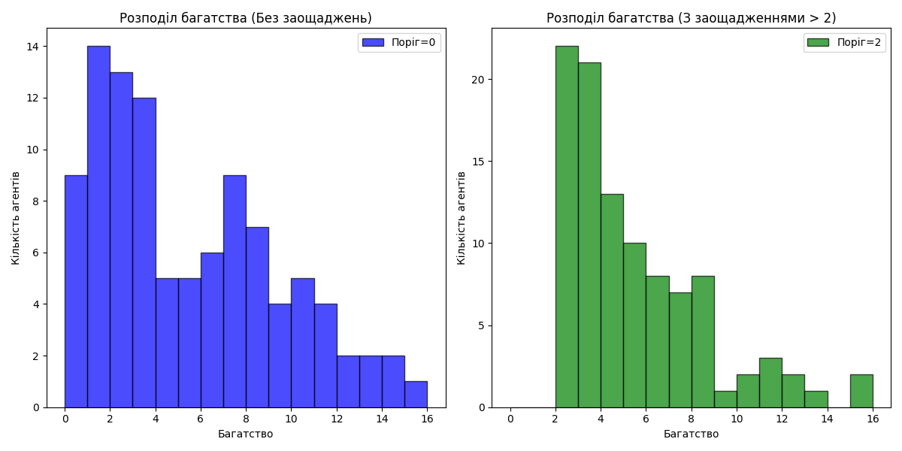
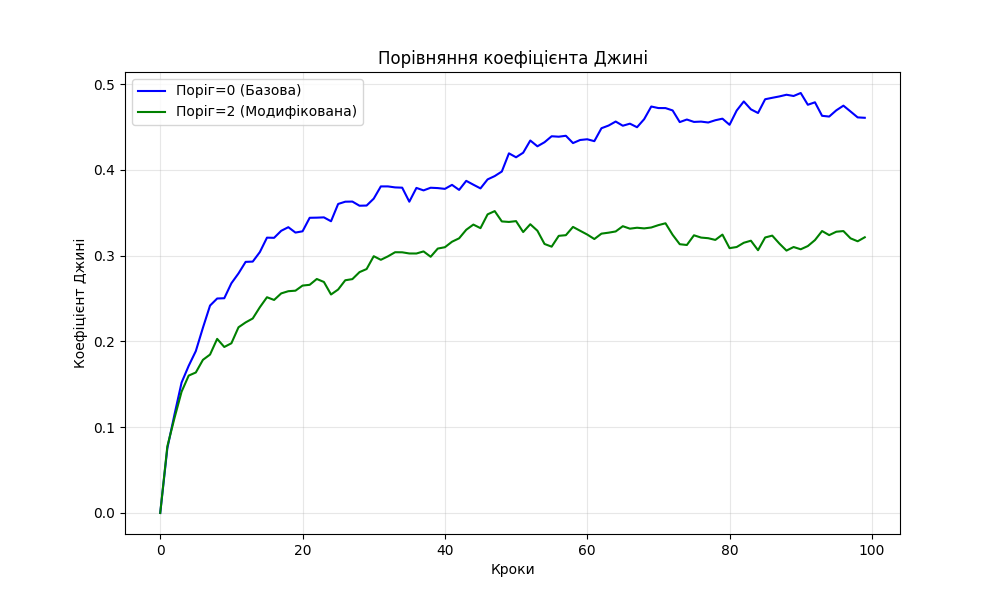

# ЗВІТ
## про виконання лабораторної роботи №6
### з дисципліни "Інтелектуальний аналіз і візуалізація даних"

**Тема:** Вивчення фреймворка Mesa для моделювання агентів

**Мета:**
1. Ознайомитися з основними принципами та можливостями фреймворка Mesa для моделювання агентів у Python.
2. Створити просту модель та візуалізувати результати.
3. Запустити та модифікувати один із прикладів з офіційного сайту.

---

### 1. Теоретичні відомості

**Agent-Based Modeling (ABM)** — це метод моделювання складних систем, що складаються з автономних агентів, які взаємодіють між собою та з навколишнім середовищем.

**Mesa** — це бібліотека Python для агентного моделювання. Вона дозволяє користувачам швидко створювати агентні моделі, візуалізувати їх у браузері або за допомогою Matplotlib та аналізувати результати.

Основні компоненти Mesa:
*   **Agent (Агент):** Базовий клас для створення агентів. Має метод `step()`, який визначає поведінку на кожному кроці.
*   **Model (Модель):** Клас, що керує всіма агентами та середовищем.
*   **Space (Простір):** Визначає структуру середовища (сітка, граф, неперервний простір).
*   **Time (Час/Планувальник):** Керує порядком активації агентів (наприклад, `RandomActivation`).
*   **DataCollector:** Збирає дані про стан моделі та агентів для подальшого аналізу.

---

### 2. Хід виконання роботи

#### Завдання 1: Створення простої моделі руху агентів

Було розроблено програмний код у файлі `simple_model.py`. Модель складається з агентів, які розміщені на сітці розміром 10x10.

**Реалізація агента (`SimpleAgent`):**
Агент має здатність рухатися у випадковому напрямку на одну клітинку (включно з діагональними напрямками).

```python
class SimpleAgent(Agent):
    def step(self):
        # Отримуємо список сусідніх клітинок
        possible_steps = self.model.grid.get_neighborhood(
            self.pos,
            moore=True,  # Включаємо діагональні напрямки
            include_center=False
        )
        # Вибираємо випадкову нову позицію
        new_position = self.random.choice(possible_steps)
        self.model.grid.move_agent(self, new_position)
```

**Реалізація моделі (`SimpleModel`):**
Модель ініціалізує 10 агентів у випадкових позиціях. Використовується `MultiGrid`, що дозволяє перебування кількох агентів в одній клітинці. Для збору даних про позиції агентів на кожному кроці використано `DataCollector`.

#### Завдання 2: Візуалізація результатів

Результати симуляції (100 кроків) були візуалізовані за допомогою бібліотеки `matplotlib`.

1.  **Траєкторія руху агента:** На графіку відображено шлях одного з агентів від початкової до кінцевої точки. Колір точок змінюється від синього до жовтого, показуючи перебіг часу.
    *(Див. файл `agent_trajectory.png`)*

2.  **Фінальні позиції:** Відображено розташування всіх 10 агентів після завершення симуляції.
    *(Див. файл `all_agents_final.png`)*

#### Завдання 3: Модифікація прикладу (Модель багатства Больцмана)

Для третього завдання було обрано класичну економічну модель "Boltzmann Wealth Model".

**Опис базової моделі:**
*   Є $N$ агентів.
*   Всі починають з однаковою кількістю грошей.
*   На кожному кроці агенти рухаються випадково.
*   Якщо в одній клітинці опиняються два агенти, вони обмінюються грошима: агент з грошима віддає 1 одиницю випадковому партнеру.

**Внесена модифікація ("Заощадження"):**
Я вирішив змінити правило обміну грошима, додавши елемент "раціональної поведінки".
У модифікованій версії (`boltzmann_model_modified.py`) агент віддає гроші **тільки якщо його поточне багатство перевищує певний поріг** (`savings_threshold`).

Код модифікованого методу `give_money`:

```python
def give_money(self):
    cellmates = self.model.grid.get_cell_list_contents([self.pos])
    if len(cellmates) > 1:
        # Агент дає гроші тільки якщо у нього більше грошей, ніж поріг
        if self.wealth > self.savings_threshold:
            other = self.random.choice(cellmates)
            other.wealth += 1
            self.wealth -= 1
```

Експеримент полягав у порівнянні двох сценаріїв:
1.  **Базова модель:** Поріг заощаджень = 0.
2.  **Модифікована модель:** Поріг заощаджень = 2.

### 3. Аналіз отриманих результатів

#### Розподіл багатства

Було побудовано гістограми розподілу багатства для обох моделей.



*   **У базовій моделі (зліва):** Розподіл наближається до експоненційного (розподіл Больцмана). Велика кількість агентів має 0 грошей, мала кількість — багато. Це демонструє сильну нерівність.
*   **У модифікованій моделі (справа):** Кількість агентів з нульовим балансом значно менша. Більшість агентів зосереджена навколо значення порогу заощаджень (2-3 одиниці). Це свідчить про те, що наявність "недоторканного запасу" стабілізує середній клас.

#### Коефіцієнт Джині

Для кількісної оцінки нерівності було розраховано коефіцієнт Джині (Gini coefficient).



*   **Результат:** Графік показує, що коефіцієнт Джині для модифікованої моделі (зелена лінія) стабільно нижчий, ніж для базової (синя лінія).
*   **Числові значення:** Середній Gini знизився з **~0.38** до **~0.29**.
*   **Інтерпретація:** Коефіцієнт 0 означає повну рівність, 1 — повну нерівність. Зниження коефіцієнта підтверджує, що введення стратегії заощаджень робить суспільство агентів більш економічно рівним.

---

### Висновки

В ході виконання лабораторної роботи:
1.  Я успішно опанував бібліотеку **Mesa** для мови програмування Python.
2.  Створив власну модель випадкового руху агентів (`SimpleModel`), навчився використовувати `MultiGrid` для просторового моделювання та `DataCollector` для аналізу даних.
3.  На практиці дослідив феномен емерджентності: прості правила локальної взаємодії агентів призводять до складних глобальних паттернів (розподіл Больцмана).
4.  Провів експериментальне дослідження впливу стратегії заощаджень на економічну нерівність. Довів, що навіть невеликий поріг заощаджень ("не витрачати останнє") суттєво зменшує майнову нерівність у системі та захищає агентів від повного банкрутства.
